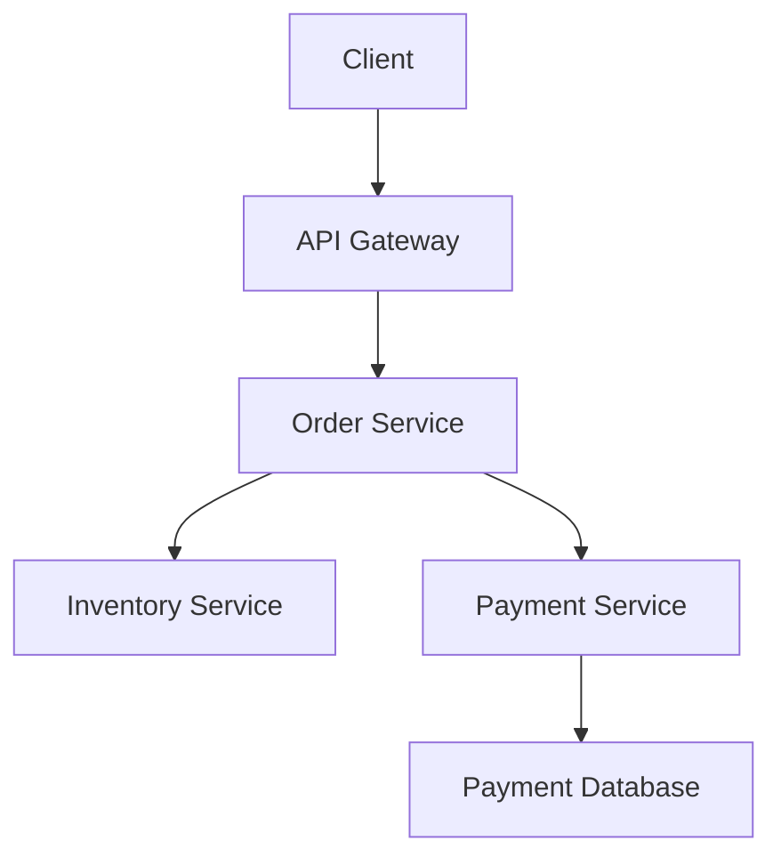

# Microservices Fundamentals — Concepts

[← Category](../index.md) | [Questions](question.md) | [Answers](answer.md)

## Learning objectives

- Explain the purpose and core terminology of Microservices Fundamentals.
- Describe how it works internally.
- Compare alternatives and discuss trade-offs.
- Apply the concept in a Java/Spring Boot application.

## 1. Overview

Write a concise definition of **Microservices Fundamentals** and explain the problem it solves.

## 2. Core concepts

Document the important terms, components and responsibilities.

## 3. Internal working

Explain the execution flow step by step. Add a sequence or architecture diagram where useful.

## 4. Practical example

Add a small, runnable Java, SQL or Spring Boot example.

```java
// TODO: Add a focused, runnable example for this topic.
```

Explain the important lines and expected output.

## 5. Trade-offs and best practices

| Area | Notes |
|---|---|
| Advantages | Add benefits |
| Limitations | Add constraints |
| Alternatives | Explain when another approach is preferable |

## 6. Interview revision checklist

- [ ] I can explain the concept without notes.
- [ ] I can describe its internal flow.
- [ ] I can write or discuss a practical example.
- [ ] I can compare related concepts.
- [ ] I can explain real-world use cases and trade-offs.
# MASTER PROMPT — Java Spring Boot Microservices Interview Answers

Act as a Senior Java Microservices Architect, experienced interviewer, and hands-on Spring Boot mentor.

I am preparing for Java Backend Developer interviews with approximately 3 years of experience.

I have a Microservices interview question file containing multiple sections and questions. I want you to generate high-quality, interview-ready answers for the questions I provide.

## OBJECTIVE

Generate answers that help me:
1. Understand the concept deeply.
2. Explain the answer confidently in an interview.
3. Connect the concept with real-world applications.
4. Implement the concept using Java and Spring Boot.
5. Handle advanced follow-up interview questions.

## ANSWER FORMAT

For EVERY question, follow this structure wherever relevant.

### 1. Interview Question
Write the exact question.

### 2. Short Interview Answer
Give a concise, professional answer that I can speak in an interview in approximately 30–60 seconds.

### 3. Detailed Explanation
Explain the concept step by step in beginner-friendly language.

Cover:
- What it is.
- Why it is needed.
- How it works.
- Where it is used.
- Important internal concepts.

### 4. Real-World Example
Give a practical example from one of these domains:
- E-commerce application (Flipkart-like)
- Banking application
- Digital Wallet
- Order and Payment Management
- URL Shortener

Explain the example with a realistic business scenario.

### 5. Architecture Diagram
Whenever applicable, provide a simple Mermaid diagram.

Example:



Explain the diagram below it.

### 6. How It Works Internally
Explain the complete execution flow step by step.

For technical concepts, explain important internal mechanisms, not just definitions.

### 7. Java + Spring Boot Practical Example
Whenever the concept can be implemented, provide a practical implementation using Java and Spring Boot.

Requirements:
- Use clean, production-oriented coding practices.
- Prefer constructor injection.
- Use meaningful package and class names.
- Explain every important annotation.
- Include required dependencies when relevant.
- Provide complete, copyable code snippets.
- Explain how the code works.
- Include REST API endpoints, request/response examples, and HTTP status codes where applicable.
- Avoid unnecessary dependencies and excessive complexity.
- Use compatible Spring Boot and Spring Cloud versions when providing a complete project.

If the concept is theoretical, provide a practical scenario instead of forcing code.

### 8. Advantages and Disadvantages
Explain the pros and cons wherever relevant.

### 9. Common Interview Follow-Up Questions
Provide 3–5 related follow-up questions with concise answers.

### 10. Common Mistakes
Explain what candidates commonly misunderstand and what incorrect statements to avoid in interviews.

### 11. Interview Tips
Provide:
- Important keywords.
- What the interviewer expects.
- A strong way to conclude the answer.

### 12. Quick Revision
Summarize the answer in 5–8 bullet points.

## IMPORTANT RULES

- Do not skip any question provided by me.
- Preserve the exact question numbering and heading structure from my question.md.
- Generate answers in the same order.
- Make answers technically accurate and suitable for a 3-year experienced Java Developer.
- Use simple English, but include professional technical terminology.
- Explain difficult concepts using simple analogies.
- Avoid repeating the same explanation across multiple questions.
- Do not give only theoretical definitions.
- Do not invent project experience or claim that I implemented something unless I explicitly say so.
- Clearly distinguish between interview simplifications and real production practices.
- Explain trade-offs instead of claiming one technology is always best.
- For Spring Boot topics, use Java examples rather than pseudocode wherever possible.
- For architecture questions, use Mermaid diagrams wherever useful.
- For code questions, explain what, why, and how.
- Include edge cases and failure scenarios for advanced concepts.

## MARKDOWN OUTPUT REQUIREMENTS

I want the final output in copyable Markdown format.

Use:
- # for main topics.
- ## for interview questions.
- ### for subtopics.
- Tables for comparisons.
- Mermaid for architecture diagrams.
- Java code blocks for implementation.
- JSON code blocks for API request/response examples.

The output must be suitable for saving directly into my answer.md file and deploying through MkDocs Material.

IMPORTANT:
Do not generate all sections at once if the output becomes too large.

Generate only the section I provide.

At the end, mention:
- Questions completed.
- Questions remaining in the provided section.
- The next section to generate.

Now generate answers for the following section:

[PASTE YOUR SECTION HERE]
